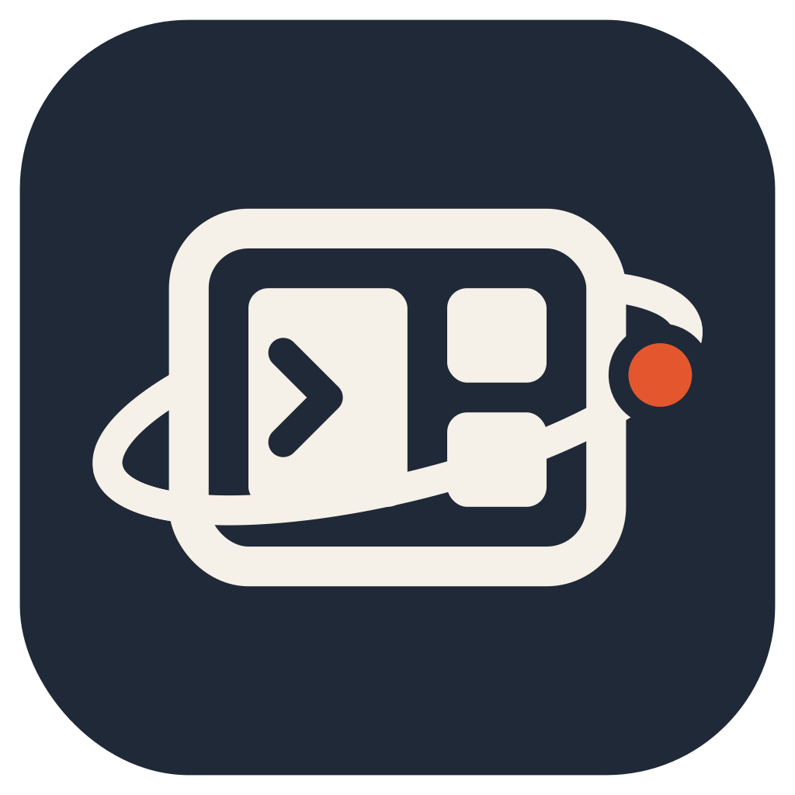

# StationDesk

Your AI agents and tools, on your own computer. StationDesk is a personal workspace
for one owner, accessed through your Tailscale identity.

[Website](https://stationdesk.ai/) · [Source](https://github.com/spacewalk-labs/stationdesk) · [Releases](https://github.com/spacewalk-labs/stationdesk/releases/latest) · [Installation guide](installer/README.md)

## Download and install

The setup app walks you through preparation, apps, Tailscale sign-in and installation.
English is the default; Korean is available. No terminal commands or StationDesk
account are needed for graphical setup. An internet connection is required.

| Computer | Download v0.1.3 | Requirements |
| --- | --- | --- |
| Mac | [StationDesk-Setup-mac.zip](https://github.com/spacewalk-labs/stationdesk/releases/download/v0.1.3/StationDesk-Setup-mac.zip) | Apple silicon; macOS 14+ for the current [OrbStack](https://orbstack.dev/download) |
| Ubuntu | [stationdesk-installer_0.1.3_all.deb](https://github.com/spacewalk-labs/stationdesk/releases/download/v0.1.3/stationdesk-installer_0.1.3_all.deb) | Ubuntu 24.04 desktop with a systemd user session |

[Release notes and SHA256 checksums](https://github.com/spacewalk-labs/stationdesk/releases/tag/v0.1.3).
The GitHub **Code → Download ZIP** button downloads source code, not the setup app.

**Mac:** unzip, move **StationDesk Setup.app** to Applications and open it.
This release is **not notarized by Apple**; macOS may block first launch.
Follow the [Mac first-open and OrbStack steps](installer/README.md#mac-apple-silicon).

**Ubuntu:** install the DEB using your graphical package installer, then open
**StationDesk Setup** from your app launcher.

Follow the app to prepare the machine, choose apps, connect Tailscale and install.
On the Ready screen choose **Open StationDesk**. Your browser device, including
the Mac hosting OrbStack, needs Tailscale signed in as the same personal owner.
See the [complete installation and first-access guide](installer/README.md).

## Install from source (terminal)

Run these commands **inside Ubuntu**, including an OrbStack Ubuntu machine on Mac.
Python 3.11+ is required. For the graphical setup app, use the downloads above.

Install Git, curl and Tailscale, log in to Tailscale, then run `bash install.sh`
from a user session with `systemd --user`. No StationDesk account or setup configuration
file is needed: the installer uses your signed-in Tailscale identity and adds the bundled apps.
```sh
git clone https://github.com/spacewalk-labs/stationdesk.git
cd stationdesk
bash install.sh
```

The installer lists its sudo work first. It also installs Claude Code, Codex,
OpenCode, and Antigravity from their official installers when missing.
Internet access is required. A failed vendor install is reported as an installation
failure; correct the reported error and retry. Model accounts and subscriptions
are separate; sign in to the agents you use.
It installs nginx if missing, creates the user-owned `/opt/stationdesk` checkout,
enables linger, and sets the installing user as Tailscale operator when Tailscale is present. The bundled hub is served by a user nginx unit on loopback,
with Tailscale Serve providing the HTTPS address. Existing system nginx is left alone.

Paseo 0.8.0 with the [documented StationDesk patches](apps/paseo/vendor/guarded-0.8.0/README.md) is included at `https://<your-tailnet-host>:19950/`, with its own
Node 22 runtime under `/opt/stationdesk/runtime/node`. Use `bash install.sh --no-paseo`
to skip adding it (this does not remove an existing installation).

`~/.local/bin/stationdesk` links to the engine. Commands:
`add <id|git-URL[#ref]|folder>`, `remove <id>`, `list [--json]`, `project`, `doctor`, `update`.
`update` only accepts fast-forward Git updates; unchanged apps are not restarted.
`doctor` must report at least one check and zero failures.

Add an external app with `stationdesk add https://example.org/apps.git#main` or
`stationdesk add /path/to/my-app`. A source can contain one `app.toml` at its root
or several apps at `apps/<id>/app.toml`. Root app IDs use the folder or repository
name (without `.git`); IDs use lowercase letters, digits and hyphens.
Git sources are cloned under `/opt/stationdesk/addons/` with your existing Git
credentials. No separate access or company policy is added by the core.
`update` fast-forwards each installed addon repository once and refreshes folder apps.
`remove <id>` deletes recorded installation paths; the last app from a cloned
repository also removes that clone. Folder sources and user data outside recorded
paths stay in place. Keep user data outside app sources and declared `files`.
The ledger and store catalog expose `origin` (`builtin`, source URL, or folder path).

Create a shortcut with `stationdesk link add "Team Wiki" https://example.org/wiki`
and remove it with `stationdesk link remove "Team Wiki"`.
Links are HTTP(S) tiles with `kind = link`; they install no app files.

Apps live in `apps/<id>`, the hub in `hub/`, and the example in `examples/hello/`.
Try `stationdesk add hello`, then `stationdesk doctor`.
See the [app contract and decisions](docs/decisions.md).

Send a card to the owner from any local agent:

```sh
stationdesk-card --group backup --level urgent --title 'Backup needs attention' --peek
stationdesk-card --group backup --title 'Backup recovered' --resolves
stationdesk-card --group review --title 'Review changes' --cwd /path/to/repo --prompt 'Review the changes'
```

Optional flags include `--body`, `--link`, and `--peek`. Open the inbox from the hub
or Porthole on any bundled app. A run card starts Claude in a new devterm tmux
session with its cwd and prompt; sign in to the installed agent CLI first.
App failures send urgent cards automatically; successful starts resolve them.

Slack is optional. Put `SLACK_WEBHOOK_URL=...`, or `SLACK_BOT_TOKEN=...` plus
`SLACK_CHANNEL=...`, in `~/.config/stationdesk/slack.env` (mode 0600).
Urgent cards wait 300 seconds before sending; `SLACK_GRACE_SECONDS` overrides it.
Recovery during that delay cancels the notification. Recovery after delivery
updates a bot message or sends a webhook follow-up. Without the file, nothing is sent.
The local HTTP ingest is `POST /monitor/api/ingest`, with JSON and
`X-StationDesk-Token` from `state/card-ingest.token`; the owner gate still applies
at the HTTPS entrance. Local producers normally use the spool CLI instead.

On macOS, `install-mac.command` creates an OrbStack Ubuntu machine and invokes the
same installer inside it. OrbStack and a logged-in Tailscale inside Ubuntu are prerequisites.

Undo the operator assignment with `sudo tailscale set --operator=`.

## Source, help and licensing

- [Report a bug](https://github.com/spacewalk-labs/stationdesk/issues) with your OS, release version and the relevant error. Remove passwords, tokens and private details from logs before posting.
- [Report security vulnerabilities privately](SECURITY.md); do not post them in a public issue.
- [Contribution policy](CONTRIBUTING.md): external code contributions are not accepted.
- StationDesk code is licensed under [AGPL-3.0](LICENSE). Third-party components retain their own licenses; see [NOTICE](NOTICE), including upstream repositories and bundled modifications.
- [App contract and decisions](docs/decisions.md) explains how to add an app. The software in this repository is the public product; setup packages are under [Releases](https://github.com/spacewalk-labs/stationdesk/releases/latest).

Run source tests with `python3 -m unittest discover tests`.
